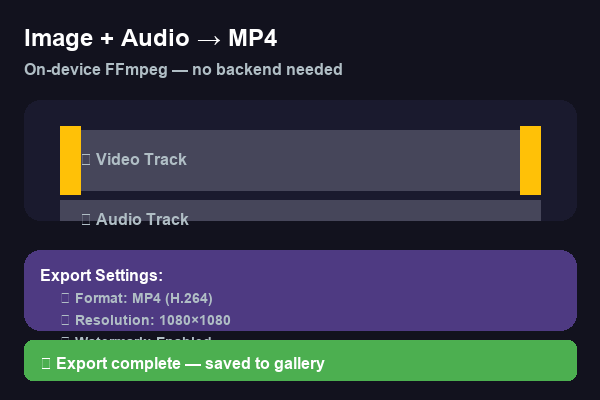
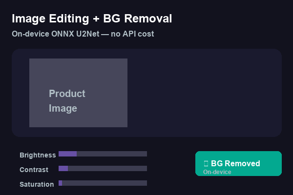
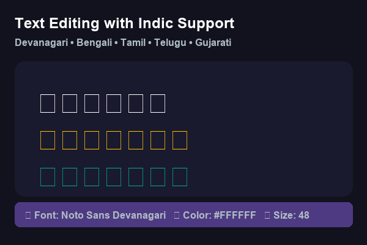
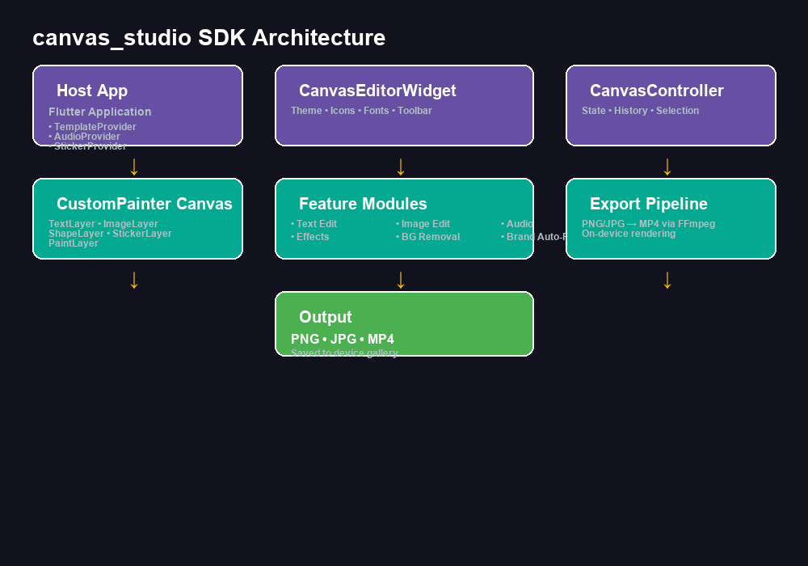
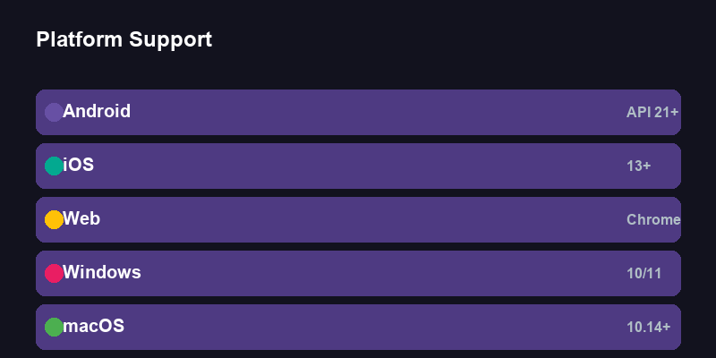
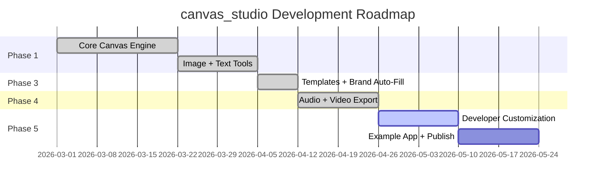

# 🎨 canvas_studio

> A lightweight, general-purpose Flutter SDK for building image & video editing canvas experiences — **offline-first, on-device, pub.dev ready**.

---

## 📸 What You'll Build

When the SDK is complete, your host app will look and feel like this:


### 🎯 End-to-End Flow

```
Template Picker  →  Canvas Editor  →  Brand Auto-Fill  →  Export  →  Share
     │                  │                 │             │          │
     ▼                  ▼                 ▼             ▼          ▼
  [Grid of          [CustomPainter     [business_name   [PNG/JPG   [WhatsApp,
   templates]         canvas +          Sharma           MP4]       Instagram]
   5 starter          RepaintBoundary   Electronics]      (on-device)
   templates]         layers)
```

---

## ✨ Features

| Feature | Description | Status | Preview |
|---------|-------------|--------|---------|
| 🖼️ **Layered Canvas** | Text, Image, Shape, Sticker, Paint layers with z-order | ✅ Done | |
| 🎬 **Video Export** | Image + audio → MP4 via on-device FFmpeg | ✅ Done |  |
| 🏷️ **Brand Auto-Fill** | PlaceholderName matching + logo injection | ✅ Done | |
| 🧹 **BG Removal** | On-device ONNX U2Net (no API cost) | ✅ Done |  |
| 🌐 **Indic Scripts** | Devanagari, Bengali, Tamil, Telugu, Gujarati | ✅ Done |  |
| 🎨 **Full Customization** | Theme, icons, fonts, toolbar, hooks | ✅ Done | |
| 📦 **Template System** | Pluggable `TemplateProvider` interface | ✅ Done | |
| 🎵 **Audio Library** | Pluggable `AudioProvider` with preview | ✅ Done | |
| ↩️ **Undo/Redo** | 50-step immutable snapshot stack | ✅ Done | |
| 📐 **Snap Lines** | Center + edge alignment guides | ✅ Done | |
| 📱 **Offline-First** | 91% of features work without internet | ✅ Done | |

---

## 🏗️ Architecture



### Layer Types

| Layer | Icon | Use Case |
|-------|------|----------|
| `TextLayer` | 📝 | Titles, descriptions, Indic script text |
| `ImageLayer` | 🖼️ | Product photos, backgrounds, logos |
| `ShapeLayer` | 🔲 | Rectangles, circles, lines, polygons |
| `StickerLayer` | ✨ | Emoji, festival elements, decorative |
| `PaintLayer` | 🖌️ | Freehand drawing, signatures |

---

## 📱 Platform Support



---

## 🚀 Quick Start

### 1. Add to `pubspec.yaml`

```yaml
dependencies:
  canvas_studio: ^0.1.0
  # Optional: for background removal
  image_background_remover: ^2.0.0
  # Optional: for video export
  ffmpeg_kit_flutter_new: ^4.1.0
```

### 2. Basic Usage

```dart
import 'package:canvas_studio/canvas_studio.dart';
import 'dart:typed_data';

class MyEditorScreen extends StatelessWidget {
  @override
  Widget build(BuildContext context) {
    final controller = CanvasController.empty(
      canvasSize: const Size(1080, 1080),
      type: CanvasMediaType.image,
    );

    // Add a title layer
    controller.addLayer(TextLayer(
      id: 'title',
      name: 'Title',
      position: const Offset(80, 400),
      size: const Size(920, 120),
      text: 'Canvas Studio',
      fontFamily: 'Roboto',
      fontSize: 72,
      color: const Color(0xFFFFFFFF),
    ));

    // Add an image layer
    controller.addLayer(ImageLayer(
      id: 'product',
      name: 'Product Image',
      position: const Offset(200, 200),
      size: const Size(400, 400),
      imageUrl: 'https://cdn.example.com/product.jpg',
    ));

    return CanvasEditorWidget(
      controller: controller,
      config: CanvasEditorConfig.defaults,
      canvasBackground: const Color(0xFF1A1A2E),
      onExportImage: (result) async {
        // result.bytes — Uint8List PNG/JPG
        // result.suggestedFileName — filename
        await saveToGallery(result.bytes);
      },
      onSaveDraft: (doc) async {
        await saveDraftToHive(doc.toJson());
      },
      onFeatureLocked: (feature) {
        showUpgradeDialog(feature);
      },
    );
  }
}
```

### 3. Load a Template

```dart
final template = await templateProvider.fetchTemplateById('tpl_business_card');
final doc = CanvasDocument(
  id: template.id,
  canvasSize: template.canvasSize,
  type: CanvasMediaType.image,
  layers: template.layers.map((l) => layerFromJson(l)).toList(),
  updatedAt: DateTime.now(),
);
controller.loadDocument(doc);
```

### 4. Apply Brand Info

```dart
controller.applyBrandProfile(BrandProfile(
  businessName: 'Sharma Electronics',
  phone: '+91 98765 43210',
  address: 'Mumbai, India',
  tagline: 'Quality Products Since 1990',
  logoUrl: 'https://cdn.example.com/logo.png',
));
// All layers with placeholderName='business_name' get auto-filled
// Text auto-shrinks to fit layer bounds
// Single undo step for the entire operation
```

### 5. Export

```dart
// PNG export
final config = controller.buildExportConfig(
  format: ExportFormat.png,
  applyWatermark: true,
);
final result = await ExportRenderer.renderToBytes(
  controller.document,
  config.format,
);
// result.bytes → Uint8List
// result.suggestedFileName → 'canvas_export_1234567890.png'

// MP4 export (image + audio)
controller.setAudio(AudioConfig(
  trackId: 'audio_01',
  trackUrl: 'https://cdn.example.com/track.mp3',
  previewUrl: 'https://cdn.example.com/preview.mp3',
  trackName: 'Diwali Beat',
  duration: Duration(minutes: 3),
));
final videoConfig = controller.buildExportConfig(
  format: ExportFormat.mp4,
);
// FFmpeg command built on-device, no backend needed
```

---

## 📱 Example App

The `example/` directory contains a complete host app demonstrating every feature:

```
example/lib/
├── main.dart                    # App entry + TemplatePickerScreen route
├── screens/
│   ├── template_picker_screen.dart  # Template grid with category filters
│   ├── editor_screen.dart           # Full CanvasEditorWidget integration
│   ├── brand_profile_screen.dart    # Brand info form + logo picker
│   └── export_result_screen.dart    # Export preview + share
└── providers/
    ├── example_template_provider.dart   # 5 starter templates
    ├── example_audio_provider.dart      # 4 tracks with festival categories
    └── example_sticker_provider.dart    # 5 stickers across 3 categories
```

Run it:

```bash
cd example
flutter pub get
flutter run
```

---

## 🛠️ Provider Interfaces (Host App Implements)

```dart
abstract class TemplateProvider {
  Future<List<TemplateManifest>> fetchTemplates({
    String? category,
    TemplateAspectRatio? ratio,
    int page = 1,
  });
  Future<TemplateManifest?> fetchTemplateById(String id);
}

abstract class AudioProvider {
  Future<List<AudioTrack>> fetchTracks({String? festival, int page = 1});
  Future<List<String>> fetchCategories();
  Future<List<AudioTrack>> fetchUserUploads();
  Future<AudioTrack> uploadAudio(String localFilePath);
  bool canAccessTrack(AudioTrack track);
}

abstract class StickerProvider {
  Future<List<StickerCategory>> fetchCategories();
  Future<List<Sticker>> fetchStickers({String? categoryId, int page = 1});
}
```

---

## 🎨 Developer Customization

| Customization | How |
|---------------|-----|
| **Theme** | `CanvasEditorTheme` (ThemeExtension) — colors, borders, radii |
| **Icons** | `CanvasEditorIcons` — override any icon with one line |
| **Fonts** | `CanvasFontConfig` — Google + asset + network + per-script Indic |
| **Toolbar** | `CanvasToolbarConfig` — custom tools, layout, labels |
| **Slots** | `SlotOverrides` — 8 builder slots for custom UI |
| **Hooks** | `onExportImage`, `onSaveDraft`, `onFeatureLocked`, `onLayerSelected` |
| **Feature Gates** | `isFeatureEnabled(EditorFeature)` + `onFeatureLocked` callback |
| **Localization** | `CanvasEditorLocalizations` — EN, HI, MR, BN presets |

---

## 📦 Size & Performance

| Metric | Target |
|--------|--------|
| Core SDK APK size | < 5 MB |
| With ONNX BG removal | +25-30 MB (optional) |
| With FFmpeg video | +15-30 MB (optional) |
| PNG export time | < 500ms (1080×1080) |
| Canvas FPS (10 layers) | 60 fps |
| Undo/redo steps | 50 |
| Offline capability | 91% of features |

---

## 📋 Roadmap



---

## 📄 License

MIT License — see [LICENSE](LICENSE) for details.

---

## 🤝 Contributing

1. Fork the repo
2. Create your feature branch (`git checkout -b feature/amazing-feature`)
3. Commit your changes (`git commit -m 'feat: add amazing feature'`)
4. Push to the branch (`git push origin feature/amazing-feature`)
5. Open a Pull Request

---

**Built with Flutter • Published on pub.dev • MIT Licensed**
